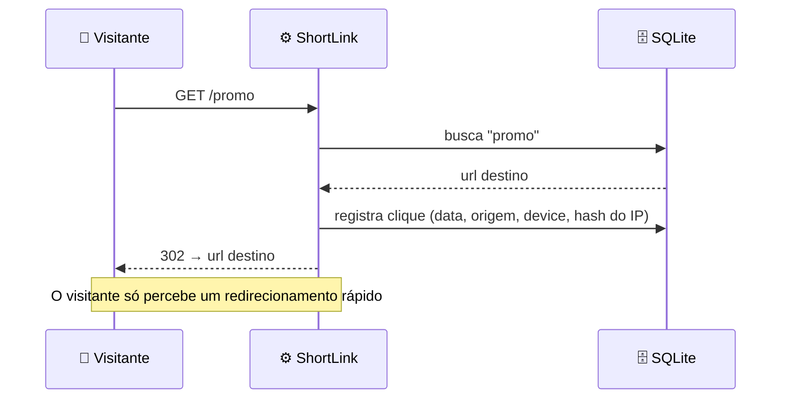

<div align="center">

# 🔗 ShortLink API

### Encurte. Compartilhe. Espie cada clique.

**Uma API de encurtador de URLs com métricas, pronta para colocar no ar em 5 minutos.**


[🚀 Rodar agora](#-missão-1--rodar-na-sua-máquina) · [☁️ Colocar no ar](#%EF%B8%8F-missão-3--colocar-no-ar-de-graça) · [🧩 Usar no seu site](#-missão-4--usar-no-seu-projeto) · [📡 Endpoints](#-referência-da-api)

</div>

---

## 🧭 Escolha seu caminho

| Eu quero... | Vá para |
|---|---|
| Entender o que é isso | [🤔 O que é](#-o-que-é) |
| Rodar no meu PC | [Missão 1](#-missão-1--rodar-na-sua-máquina) |
| Testar a API sem programar | [Missão 2](#-missão-2--brincar-com-a-api) |
| Colocar na internet | [Missão 3](#%EF%B8%8F-missão-3--colocar-no-ar-de-graça) |
| Usar no meu site/portfólio | [Missão 4](#-missão-4--usar-no-seu-projeto) |
| Entender por dentro | [⚙️ Como funciona](#%EF%B8%8F-como-funciona-por-dentro) |

---

## 🤔 O que é

O **ShortLink** transforma isto:

```
https://meusite.com/blog/2026/10/como-aprender-javascript-do-zero?utm_source=newsletter&utm_campaign=outubro
```

nisto:

```
https://seu-app.onrender.com/js-zero
```

e ainda te conta **quantas pessoas clicaram, quando, de onde vieram e em que dispositivo**.

### ✨ O que ele faz

- ✂️ **Encurta** qualquer URL `http/https` (código aleatório ou **alias personalizado**)
- 📊 **Conta cliques** totais e **visitantes únicos**
- 🕒 **Guarda metadados**: data/hora, origem (referrer), dispositivo e navegador
- ⏳ **Links com validade** (expiram sozinhos)
- 🤖 **Ignora bots** (prévia do WhatsApp, Googlebot etc. não inflam seus números)
- 🔐 **Privacidade (LGPD-friendly)**: o IP nunca é salvo, apenas um hash irreversível com sal
- 🛡️ Rate limit, validação de URL, Helmet, CORS configurável
- 🖥️ Inclui um **front-end pronto** (`public/index.html`) para você usar de demo ou base do seu portfólio

---

## 🚀 Missão 1 — Rodar na sua máquina

> Pré-requisito: [Node.js 18+](https://nodejs.org) (`node -v` para conferir) e Git.

```bash
# 1. baixe o projeto
git clone https://github.com/SEU-USUARIO/shortlink-api.git
cd shortlink-api

# 2. instale as dependências
npm install

# 3. crie sua configuração
cp .env.example .env        # no Windows (cmd): copy .env.example .env

# 4. ligue!
npm start
```

Abra **http://localhost:3000** 🎉 — você verá o front-end de demonstração.

<details>
<summary>🐳 Prefere Docker?</summary>

```bash
docker build -t shortlink .
docker run -p 3000:3000 -v shortlink-data:/data -e API_KEY=minha-chave shortlink
```
</details>

<details>
<summary>🧪 Rodar os testes</summary>

```bash
npm test
```
</details>

---

## 🎮 Missão 2 — Brincar com a API

Com o servidor ligado, abra outro terminal:

**① Criar um link**
```bash
curl -X POST http://localhost:3000/api/links \
  -H "Content-Type: application/json" \
  -d '{"url":"https://github.com","alias":"gh"}'
```
Resposta:
```json
{
  "code": "gh",
  "url": "https://github.com/",
  "shortUrl": "http://localhost:3000/gh",
  "statsUrl": "http://localhost:3000/api/links/gh/stats",
  "createdAt": "2026-10-30T12:00:00.000Z",
  "expiresAt": null
}
```

**② Clicar** → abra `http://localhost:3000/gh` no navegador (você será redirecionado).

**③ Ver as métricas**
```bash
curl http://localhost:3000/api/links/gh/stats
```
```json
{
  "code": "gh",
  "totalClicks": 1,
  "uniqueVisitors": 1,
  "clicksByDay": [{ "date": "2026-10-30", "clicks": 1 }],
  "topReferrers": [{ "name": "direto/desconhecido", "clicks": 1 }],
  "devices": [{ "name": "desktop", "clicks": 1 }],
  "browsers": [{ "name": "Chrome", "clicks": 1 }],
  "recentClicks": [ ... ]
}
```

> 💡 `curl` e bots **não** contam como clique (de propósito). Para testar, use o navegador.

---

## ☁️ Missão 3 — Colocar no ar (de graça)

Para **testes pequenos**, estas são as opções mais simples. *(Planos gratuitos mudam com frequência: confirme os limites atuais no site de cada serviço.)*

| Serviço | Dificuldade | Dados persistem? | Ideal para |
|---|---|---|---|
| **Render** ⭐ | 🟢 Fácil | ⚠️ Não no plano grátis | Demo/portfólio, o mais simples |
| **Railway** | 🟢 Fácil | ✅ Com Volume | Testes com dados que ficam |
| **Fly.io** | 🟡 Média | ✅ Com Volume | Quem quer mais controle |
| **Koyeb** | 🟢 Fácil | ⚠️ Verifique o plano | Alternativa ao Render |
| **VPS** (Oracle Free, Hetzner, etc.) | 🔴 Mais trabalho | ✅ Sim | Uso sério de longo prazo |
| **Seu PC + Cloudflare Tunnel** | 🟢 Fácil | ✅ Sim | Testar rapidinho e mostrar a alguém |

### ⚠️ Entenda isto antes de escolher: persistência

O ShortLink guarda tudo em um arquivo SQLite. Em hospedagens gratuitas **sem disco persistente**, o arquivo é apagado quando o serviço reinicia ou reimplanta. Para demo, tudo bem. Para links que precisam durar, use um **volume/disco persistente** (Railway, Fly.io, VPS) e aponte `DB_PATH` para ele.

Outra coisa comum: planos grátis **"dormem"** após um tempo sem uso, então o primeiro acesso depois pode levar alguns segundos.

### 🥇 Opção A — Render (recomendada para começar)

1. Suba o projeto para o **seu GitHub** (`git push`).
2. Crie conta em [render.com](https://render.com) e clique em **New → Blueprint**.
3. Escolha seu repositório. O Render lê o `render.yaml` e configura tudo sozinho (comando de build, start, health check, `API_KEY` e `IP_SALT` gerados automaticamente).
4. Quando pedir **`BASE_URL`**, deixe em branco por ora. Aguarde o deploy.
5. Copie a URL que o Render gerou (ex: `https://shortlink-api-xxxx.onrender.com`), vá em **Environment** e preencha `BASE_URL` com ela. Salve (ele reinicia).
6. Teste: `https://sua-url.onrender.com/health` deve responder `{"status":"ok"}`.

<details>
<summary>Prefere criar manualmente (sem Blueprint)?</summary>

**New → Web Service** → escolha o repo → *Runtime:* Node → *Build:* `npm install` → *Start:* `npm start` → plano Free → adicione as variáveis de ambiente da tabela abaixo.
</details>

### 🚆 Opção B — Railway (com dados persistentes)

1. [railway.app](https://railway.app) → **New Project → Deploy from GitHub repo**.
2. Em **Variables**, adicione `API_KEY`, `IP_SALT`, `BASE_URL`.
3. Em **Settings → Networking**, clique em **Generate Domain**.
4. Em **Volumes**, crie um volume montado em `/data` e adicione a variável `DB_PATH=/data/shortlink.db`.

### 🪁 Opção C — Fly.io (Docker + volume)

```bash
fly launch --no-deploy            # detecta o Dockerfile
fly volumes create data --size 1  # disco persistente de 1 GB
# no fly.toml, adicione:
#   [mounts]
#     source = "data"
#     destination = "/data"
fly secrets set API_KEY=$(openssl rand -hex 24) IP_SALT=$(openssl rand -hex 16)
fly deploy
```

### 🏠 Opção D — Seu PC exposto na internet (teste relâmpago)

```bash
npm start
# em outro terminal (instale o cloudflared antes):
cloudflared tunnel --url http://localhost:3000
```
Ele imprime uma URL pública temporária. Coloque-a em `BASE_URL` no `.env` e reinicie. Ótimo para mostrar a um amigo, mas o link morre quando você fecha o terminal.

### 🔧 Variáveis de ambiente

| Variável | O que faz | Padrão |
|---|---|---|
| `PORT` | Porta (hospedagens definem sozinhas) | `3000` |
| `BASE_URL` | URL pública usada nos links curtos | detecta pelo request |
| `API_KEY` | Chave das rotas admin (listar/deletar) | *(vazio = admin desligado)* |
| `CREATE_REQUIRES_KEY` | `true` = criar links também exige a chave | `false` |
| `CORS_ORIGIN` | Sites autorizados, separados por vírgula, ou `*` | `*` |
| `IP_SALT` | Sal do hash de IP, use texto aleatório | `dev-salt` |
| `DB_PATH` | Caminho do arquivo SQLite | `./data/shortlink.db` |
| `RATE_LIMIT` | Máx. de criações por minuto por IP | `20` |

### ✅ Checklist antes de divulgar sua URL

- [ ] `API_KEY` forte configurada
- [ ] `IP_SALT` trocado
- [ ] `BASE_URL` com a URL real
- [ ] `CORS_ORIGIN` restrito ao(s) seu(s) site(s)
- [ ] Considerou `CREATE_REQUIRES_KEY=true`? (evita que estranhos usem seu serviço para encurtar links maliciosos)

---

## 🧩 Missão 4 — Usar no seu projeto

Já com a API no ar (ex: `https://seu-app.onrender.com`), integre em qualquer site.

> 🔑 **Importante:** em `CORS_ORIGIN`, coloque o domínio do seu site (ex: `https://meusite.com`), senão o navegador bloqueia a chamada.
> 🚫 **Nunca coloque a `API_KEY` no código do front-end.** Ela fica visível para qualquer pessoa. Se precisar proteger a criação, chame a API pelo **seu próprio backend**.

### HTML + JavaScript puro

```html
<input id="url" placeholder="Cole sua URL">
<button onclick="encurtar()">Encurtar</button>
<p id="resultado"></p>

<script>
  const API = 'https://seu-app.onrender.com';

  async function encurtar() {
    const resp = await fetch(`${API}/api/links`, {
      method: 'POST',
      headers: { 'Content-Type': 'application/json' },
      body: JSON.stringify({ url: document.getElementById('url').value })
    });
    const dados = await resp.json();
    document.getElementById('resultado').textContent =
      resp.ok ? dados.shortUrl : `Erro: ${dados.error}`;
  }
</script>
```

### React

```jsx
import { useState } from 'react';
const API = import.meta.env.VITE_SHORTLINK_API; // https://seu-app.onrender.com

export function useShortLink() {
  const [loading, setLoading] = useState(false);

  async function shorten(url, alias) {
    setLoading(true);
    try {
      const r = await fetch(`${API}/api/links`, {
        method: 'POST',
        headers: { 'Content-Type': 'application/json' },
        body: JSON.stringify({ url, alias })
      });
      const data = await r.json();
      if (!r.ok) throw new Error(data.error);
      return data; // { code, shortUrl, statsUrl, ... }
    } finally {
      setLoading(false);
    }
  }

  async function stats(code) {
    const r = await fetch(`${API}/api/links/${code}/stats`);
    return r.json();
  }

  return { shorten, stats, loading };
}
```

### Painel de cliques em 5 linhas

```js
const s = await (await fetch(`${API}/api/links/meu-link/stats`)).json();
console.log(`${s.totalClicks} cliques de ${s.uniqueVisitors} pessoas`);
// s.clicksByDay já vem pronto para alimentar Chart.js, Recharts etc.
```

### Usando o front-end que já vem pronto

O `public/index.html` funciona **junto da API** (mesmo domínio) sem mudar nada. Para hospedá-lo separado (GitHub Pages, Netlify), copie o arquivo e altere a linha `const API = ''` para a URL da sua API.

---

## 📡 Referência da API

| Método | Rota | Auth | Descrição |
|---|---|---|---|
| `POST` | `/api/links` | opcional* | Cria um link curto |
| `GET` | `/:code` | — | Redireciona (302) e registra o clique |
| `GET` | `/api/links/:code/stats` | — | Métricas do link |
| `GET` | `/api/links?limit=50` | 🔐 `x-api-key` | Lista links |
| `DELETE` | `/api/links/:code` | 🔐 `x-api-key` | Apaga link e seus cliques |
| `GET` | `/health` | — | Health check |

\* exige chave se `CREATE_REQUIRES_KEY=true`: envie o header `x-api-key: SUA_CHAVE`.

**Corpo do `POST /api/links`**

| Campo | Tipo | Obrigatório | Exemplo |
|---|---|---|---|
| `url` | string | ✅ | `"https://exemplo.com/pagina"` |
| `alias` | string | ❌ | `"promo-natal"` (3-32 chars: letras, números, `-`, `_`) |
| `expiresAt` | string ISO | ❌ | `"2026-12-31T23:59:59Z"` |

**Códigos de resposta:** `201` criado · `400` dado inválido · `401` chave errada · `403` admin desativado · `404` não encontrado · `409` alias já existe · `410` link expirado · `429` limite excedido.

---

## ⚙️ Como funciona por dentro



**Estrutura**
```
shortlink-api/
├── src/
│   ├── server.js     # rotas, validações, redirecionamento, métricas
│   └── db.js         # conexão SQLite e criação das tabelas
├── public/
│   └── index.html    # front-end de demonstração
├── test/api.test.js  # testes automatizados
├── Dockerfile
├── render.yaml       # deploy 1-clique no Render
└── .env.example
```

**Decisões de projeto (e por quê)**

- **302 e não 301:** o 301 é cacheado pelo navegador, então cliques repetidos nem chegariam ao servidor e você perderia métricas.
- **SQLite:** zero instalação, um único arquivo, perfeito para projetos pequenos. Se o projeto crescer, a troca para PostgreSQL é concentrada em `db.js`.
- **Hash do IP em vez do IP:** permite contar visitantes únicos sem guardar dado pessoal identificável.
- **Filtro de bots:** previews de apps de mensagem não viram "cliques".
- **Alias reservados:** `api`, `health`, `admin` etc. não podem ser usados, evitando conflito de rotas.

**Banco de dados**

| Tabela `links` | Tabela `clicks` |
|---|---|
| `code` (PK), `url`, `created_at`, `expires_at`, `clicks` | `id`, `code` (FK), `clicked_at`, `referrer`, `device`, `browser`, `ip_hash` |

---

## 🗺️ Ideias para evoluir

- [ ] QR Code automático para cada link (`/api/links/:code/qr`)
- [ ] Painel admin com login
- [ ] Geolocalização por país
- [ ] Troca do SQLite por PostgreSQL
- [ ] Edição do destino de um link existente
- [ ] Senha opcional por link

## ❓ Problemas comuns

<details><summary>Meu link curto aparece com <code>localhost</code> em produção</summary>
Defina <code>BASE_URL</code> com a URL pública do seu serviço.
</details>

<details><summary>O navegador mostra erro de CORS</summary>
Coloque o domínio exato do seu site (com <code>https://</code>, sem barra no final) em <code>CORS_ORIGIN</code>.
</details>

<details><summary>Meus links sumiram depois de um tempo</summary>
Você está em hospedagem sem disco persistente. Veja a seção de persistência na Missão 3.
</details>

<details><summary>Os cliques não aumentam quando testo com curl</summary>
É intencional: curl é tratado como bot. Teste pelo navegador.
</details>

<details><summary>O primeiro acesso demora uns segundos</summary>
Normal em planos gratuitos que "dormem" quando ficam sem uso.
</details>

## 📄 Licença

MIT, use, modifique e compartilhe à vontade.

<div align="center">

Feito para ser simples de rodar, fácil de entender e legal de mostrar no portfólio. ⭐ Se foi útil, deixe uma estrela no repo!

</div>
